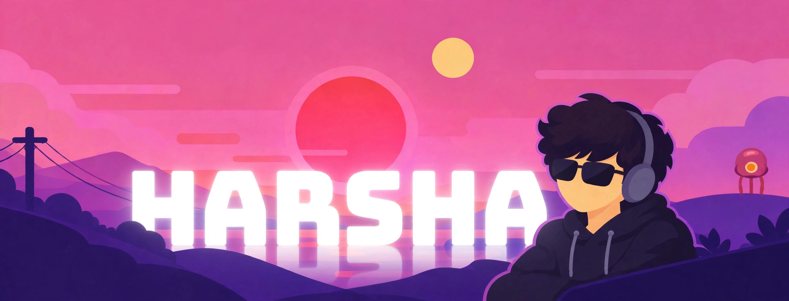
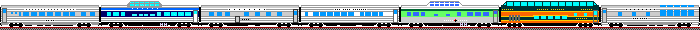
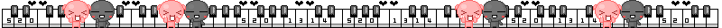

  

  

  
<strong>First-Year Computer Science Student @ BMSCE</strong>

  

    Learning deeply, building practical projects, and strengthening my problem-solving skills through algorithms, competitive programming, and development.
  

  

    
    
    
    
    
  

  

**👨‍💻 About Me**

- 🎓 First-year Computer Science student at BMSCE.
- 🧩 Solved 100+ problems on LeetCode.
- 💻 Exploring competitive programming and algorithmic problem solving.
- 🛠️ Building practical projects while strengthening my programming fundamentals.
- 🤖 Working toward a deeper understanding of AI/ML and data science.

  

**🛠️ Tech Stack & Skills**

**Languages**

**Web Development**

**Tools & Platforms**

**Currently Exploring**

`Data Structures & Algorithms` · `Competitive Programming` · `AI/ML Fundamentals`

  

**🧠 Problem Solving**

  
  

Improving my problem-solving skills through DSA practice, contest participation, and learning the reasoning behind each solution.

---

**📊 GitHub Statistics**

  
  

  

  

  <i>Learn. Build. Solve. Repeat.</i>

